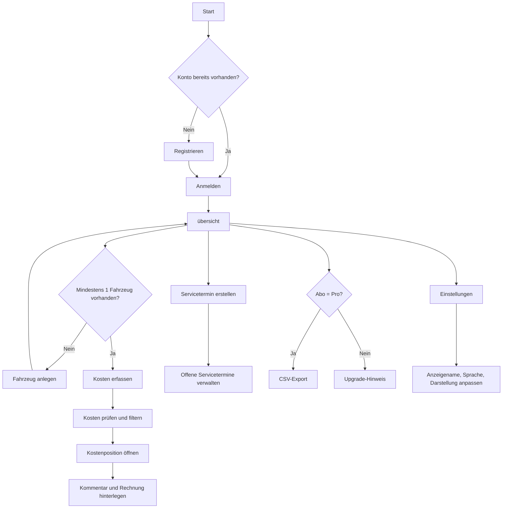
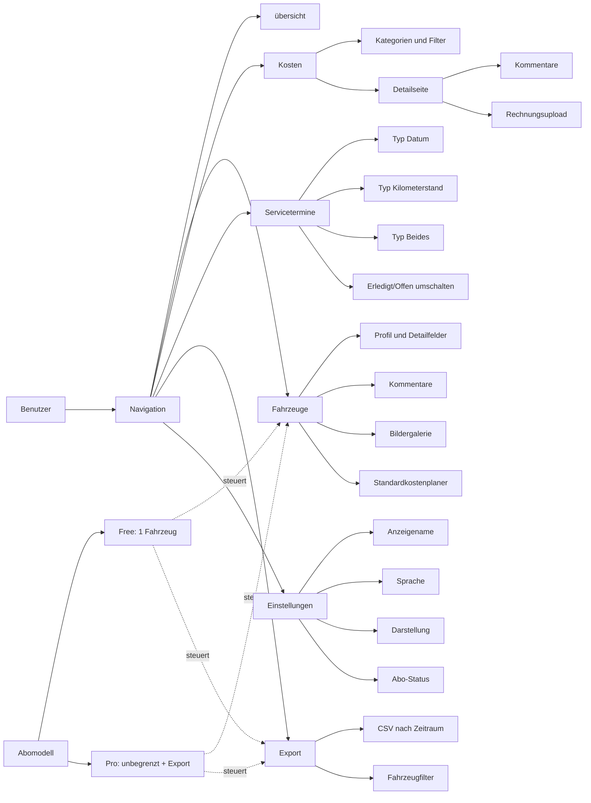

# CarMan Benutzerhandbuch

Dieses Handbuch richtet sich an neue Benutzer und erklärt die wichtigsten Funktionen von CarMan Schritt für Schritt.

## 1. Ziel und Aufbau

Mit CarMan verwaltest du Fahrzeuge, laufende Kosten, Servicetermine und (im Pro-Tarif) Exporte in einer zentralen Webanwendung.

Dieses Handbuch führt dich in dieser Reihenfolge durch das System:
1. Anmeldung und Einstieg
2. übersicht und Navigation
3. Fahrzeuge
4. Kosten
5. Servicetermine
6. Export
7. Einstellungen und Abo
8. Fehlerbehebung und häufige Fragen

## 2. Schnellstart in 5 Minuten

1. öffne die Anwendung im Browser.
2. Melde dich mit einem Konto an.
3. Wechsle zur übersicht und prüfe die wichtigsten Kennzahlen.
4. Lege ein Fahrzeug an (falls noch keines vorhanden ist).
5. Erfasse den ersten Kosteneintrag.
6. Erstelle mindestens eine Servicetermin.

### Testbenutzer (lokale Umgebung)

Für lokale Tests stehen zwei Benutzer aus `docs/testbenutzer.md` bereit:

| Konto | E-Mail | Passwort | Zweck |
|---|---|---|---|
| Free | `free@testBenutzer.local` | `Test1234!` | Test des Free-Limits (1 Fahrzeug, kein Export) |
| Pro | `pro@testBenutzer.local` | `Test1234!` | Test von mehreren Fahrzeugen und CSV-Export |

Hinweis: Diese Zugangsdaten sind nur für lokale Testumgebungen gedacht.

## 3. Hauptprozesse auf einen Blick

### 3.1 Durchgängiger Prozessfluss

### 3.2 Funktionskarte des Systems

## 4. Anmeldung und Konto

### 4.1 Registrieren

Pfad: `/register`

1. Gib Anzeigename, E-Mail und Passwort ein.
2. Das Passwort muss mindestens 6 Zeichen haben.
3. Sende das Formular ab.
4. Bei Erfolg erscheint eine Bestätigung.

Typische Fehler:
- Fehlende Felder: Bitte alle Felder ausfällen.
- Passwort zu kurz: Mindestens 6 Zeichen.
- Technischer Fehler: Registrierung erneut versuchen.

### 4.2 Anmelden

Pfad: `/login`

1. E-Mail und Passwort eingeben.
2. Formular absenden.
3. Bei Erfolg erfolgt die Weiterleitung zur übersicht.

Typische Fehler:
- Falsche Zugangsdaten: Der Anmeldeversuch wird mit Fehlermeldung abgelehnt.

### 4.3 Automatische Weiterleitung

- Wenn du eingeloggt bist und die Startseite öffnest, wirst du direkt auf `/dashboard` geleitet.
- Wenn du nicht eingeloggt bist und geschützte Bereiche aufrufst, gelangst du zur Anmeldung.

## 5. Navigation und übersicht

### 5.1 Hauptnavigation

In der Seitenleiste findest du diese Bereiche:
- Dashboard
- Fahrzeuge
- Kosten
- Servicetermine
- Export
- Einstellungen

Zusätzliche Funktionen:
- Kontoanzeige mit Free/Pro-Kennzeichnung
- Abmelden
- Sprache und Darstellung

### 5.2 übersicht verstehen

Pfad: `/dashboard`

Die übersicht zeigt dir unter anderem:
- Aktuelle Monatskosten
- Kosten des Vormonats
- Anzahl der Fahrzeuge
- Offene Servicetermine

Direktaktionen auf der übersichtsseite:
- Neuer Kosteneintrag
- Neue Servicetermin
- Neues Fahrzeug

Weitere Inhalte:
- Fokusfahrzeug mit letzter Aktivität
- Verbindungswert
- Fahrzeugkarten mit Kennzahlen
- Einstieg in den großen Kostenverlauf

### 5.3 Großer Kostenverlauf

Pfad: `/dashboard/cost-trend`

1. öffne den Bereich „Kostenverlauf groß“.
2. Stelle Kategorien, Fahrzeuge und Zeitraum ein.
3. Werte bleiben auf Monatsbasis.
4. Nutze die Ansicht für Trends und Vergleiche.

## 6. Fahrzeuge verwalten

### 6.1 Fahrzeugliste

Pfad: `/vehicles`

Die Seite zeigt alle Fahrzeugkarten inklusive:
- Grunddaten (Marke, Modell, Jahr, Kennzeichen)
- Kilometerstand
- Betriebskosten
- Kaufpreis
- Gesamtaufwand

### 6.2 Neues Fahrzeug anlegen

Pfad: `/vehicles/new`

1. Optional: VIN/Fahrgestellnummer eingeben und per VIN vorbefällen.
2. Pflichtfelder sauber ausfällen (Marke, Modell, Jahr, Kennzeichen, Kilometerstand).
3. Optionale Detailfelder ergänzen (z. B. Variante, Motor, Getriebe, Kaufpreis, Kaufdatum).
4. Speichern.

Wichtige Hinweise:
- Free-Tarif erlaubt maximal 1 Fahrzeug.
- Pro-Tarif erlaubt unbegrenzt viele Fahrzeuge.
- Bei erreichtem Free-Limit wird ein Upgrade-Hinweis angezeigt.

### 6.3 Fahrzeugdetailseite

Pfad: `/vehicles/[id]`

Hier findest du:
- Schnellaktionen (Tanken, Wartung, Kosten, Servicetermin)
- Kennzahlen (Betriebskosten, Kaufpreis, Gesamtaufwand)
- Fahrzeug-übersicht (24 Monate, Verteilungen, Durchschnittswerte)
- Kostenverlauf je Kategorie
- Standardkostenplaner
- Fahrzeugdaten bearbeiten
- Fahrzeugkommentare
- Fahrzeugbildergalerie inklusive Upload

## 7. Kosten erfassen und analysieren

### 7.1 Kostenübersicht

Pfad: `/costs`

1. Optional nach Fahrzeug und/oder Kategorie filtern.
2. Tabelle mit Datum, Kategorie, Titel, Fahrzeug und Betrag lesen.
3. Titel anklicken, um zur Detailseite zu wechseln.
4. Bei Bedarf durch Seiten blättern.

Unterstützte Kategorien:
- Tanken
- Wartung
- Reparatur
- Versicherung
- Steuer
- Leasing
- Parken
- Sonstiges

### 7.2 Neuer Kosteneintrag

Pfad: `/costs/new`

1. Fahrzeug auswählen.
2. Kategorie festlegen.
3. Titel, Betrag und Datum ausfällen.
4. Optional Kilometerstand eintragen.
5. Bei Kategorie Tanken zusätzlich Liter und Preis pro Liter erfassen.
6. Optional Notizen ergänzen.
7. Speichern.

Wichtige Eingabegrenzen:
- Betrag: max. 999999.99
- Kilometerstand: max. 9999999
- Liter: max. 999.999
- Preis pro Liter: max. 99.999

Hinweis: Ohne vorhandenes Fahrzeug kannst du keine Kosten erfassen.

### 7.3 Kostenposition im Detail

Pfad: `/costs/[id]`

Die Detailseite bietet:
- Kerndaten der Position (Betrag, Datum, Kategorie, Kilometerstand)
- Notizbereich
- Kommentare je Kostenposition
- Rechnungsupload und Dokumentliste
- Direktlink für einen ähnlichen Eintrag

## 8. Servicetermine

### 8.1 Serviceterminsübersicht

Pfad: `/Service appointments`

- Servicetermine werden nach Fahrzeug gruppiert.
- Erledigte Einträge lassen sich ein- und ausblenden.
- Jede Servicetermin kann als erledigt markiert oder wieder geöffnet werden.

### 8.2 Neue Servicetermin erstellen

Pfad: `/Service appointments/new`

1. Fahrzeug wählen.
2. Titel vergeben.
3. Serviceterminsart auswählen:
   - Datum
   - Kilometerstand
   - Beides
4. Je nach Typ Serviceterminsdatum und/oder Kilometerstand setzen.
5. Optional Notiz hinterlegen.
6. Speichern.

Hinweis: Ohne Fahrzeug kann keine Servicetermin erstellt werden.

## 9. Export (Pro)

Pfad: `/export`

Nur Pro-Benutzer können exportieren.

### 9.1 CSV-Export erstellen

1. Optional ein Fahrzeug auswählen, sonst alle Fahrzeuge.
2. Optional Von-/Bis-Datum setzen.
3. Export starten.
4. CSV-Datei wird im Browser heruntergeladen.

CSV enthält unter anderem:
- Datum
- Fahrzeug
- Kennzeichen
- Kategorie
- Titel
- Betrag
- Kilometerstand
- Liter
- Preis pro Liter
- Notizen

Typische Meldungen:
- Free-Tarif: Pro-Funktion gesperrt.
- Keine Daten im Zeitraum: Export nicht möglich.

## 10. Einstellungen und Abo

Pfad: `/settings`

Hier kannst du:
- Profilinformationen einsehen (E-Mail, Mitglied seit)
- Anzeigename aktualisieren
- Sprache und Darstellung ändern
- Abo-Status (Free/Pro) sehen

Bei Free wird ein Upgrade-Hinweis angezeigt.

## 11. Empfohlene Vorgehensweisen für neue Benutzer

1. Lege zuerst dein Fahrzeugprofil vollständig an.
2. Erfasse Kosten möglichst zeitnah nach dem jeweiligen Ereignis.
3. Trage beim Tanken immer Kilometerstand, Liter und Preis pro Liter ein.
4. Nutze Kommentare für Kontext (Werkstatt, Besonderheiten, Entscheidungen).
5. Hinterlege Rechnungen direkt an der Kostenposition.
6. Setze Servicetermine bei wichtigen Terminen möglichst als Typ „Beides“.
7. Nutze die Trendansichten monatlich für deine Kostenkontrolle.

## 12. Fehlerbehebung und häufige Fragen

| Problem | Mögliche Ursache | Lösung |
|---|---|---|
| Anmeldung funktioniert nicht | E-Mail/Passwort falsch | Zugangsdaten prüfen und erneut anmelden |
| Registrierung klappt nicht | Passwort zu kurz oder Felder unvollständig | Mindestens 6 Zeichen nutzen, alle Felder ausfällen |
| Kein Kosteneintrag möglich | Es existiert noch kein Fahrzeug | Zuerst Fahrzeug unter `/vehicles/new` anlegen |
| Keine Servicetermin möglich | Es existiert noch kein Fahrzeug | Zuerst Fahrzeug anlegen |
| Zweites Fahrzeug im Free-Tarif blockiert | Fahrzeuglimit erreicht | Upgrade auf Pro oder bestehendes Fahrzeug weiterverwenden |
| Export nicht verfügbar | Konto ist Free | Pro-Tarif nutzen |
| Export liefert keine Datei | Keine Daten für den gewählten Zeitraum | Zeitraum erweitern oder Fahrzeugfilter entfernen |
| Rechnungslink nicht verfügbar | Signierter Link nicht erzeugt | Seite neu laden und erneut prüfen |

## 13. Testabläufe für den Einstieg

### 13.1 Free-Szenario

1. Anmeldung mit `free@testBenutzer.local`.
2. Fahrzeugbestand prüfen (1 Fahrzeug).
3. Zweites Fahrzeug anlegen versuchen (Upgrade-Hinweis erwarten).
4. Kosten erfassen und Kosten-Detailseite prüfen.
5. Kommentar und Rechnung an einer Kostenposition testen.
6. Servicetermin erstellen und als erledigt markieren.
7. Exportseite öffnen (gesperrt erwarten).

### 13.2 Pro-Szenario

1. Anmeldung mit `pro@testBenutzer.local`.
2. Mehrere Fahrzeuge prüfen.
3. Kosten je Fahrzeug erfassen.
4. Dashboard und großen Kostenverlauf mit Filtern testen.
5. Export mit Datumsbereich ausführen und CSV öffnen.

## 14. Kurzreferenz

- Dashboard: Gesamtüberblick und schnelle Aktionen
- Fahrzeuge: Stammdaten, Kostenkontext, Bilder, Kommentare
- Kosten: Erfassung, Filterung, Detaildokumentation
- Servicetermine: Servicetermine nach Zeit und Laufleistung
- Export: CSV-Berichte (Pro)
- Einstellungen: Profil, Sprache, Darstellung, Abo

Wenn du als neuer Benutzer nur eine Reihenfolge befolgen möchtest, dann diese:
1. Anmelden
2. Fahrzeug prüfen/anlegen
3. Kosten erfassen
4. Servicetermin setzen
5. Monatsverlauf ansehen

